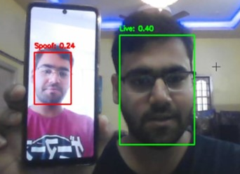
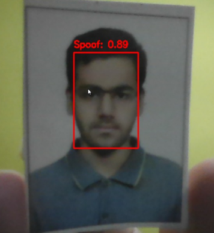

# FASECURE-Face-Anti-Spoofing

<div align="center">

### Real-Time Face Anti-Spoofing using Deep Learning

Detecting presentation attacks using a **CDCN++-inspired architecture**, **PyTorch**, and **OpenCV**.

<!-- Add Hero Image Here -->
<!-- Example: assets/hero.png -->

</div>

---

##  Overview

FASECURE is a real-time **Face Anti-Spoofing (FAS)** system that distinguishes genuine users from common presentation attacks such as printed photographs and replay attacks displayed on digital screens.

The project integrates OpenCV-based face detection with a CDCN++-inspired deep learning architecture to perform binary **Live / Spoof** classification directly from a webcam feed.

Designed as an end-to-end computer vision project, FASECURE demonstrates how deep learning and computer vision can be combined to strengthen biometric authentication systems through real-time liveness detection.

---

##  Features

- 🎥 Real-time webcam inference
- 👥 Multiple face detection with independent liveness classification
- 👤 Automatic face detection using OpenCV DNN
- 🧠 CDCN++-inspired deep learning architecture
- 🎯 Binary Live / Spoof classification
- 🔍 Attention-based feature refinement
- ⚡ CPU and CUDA inference support
- 📦 Lightweight trained model (~9 MB)
- 🧩 Modular PyTorch implementation

---

##  Sample Results

<div align="center">

### Live Face vs. Replay Attack



*The system correctly classifies the real user as **Live** while detecting the replay attack displayed on a smartphone as **Spoof**.*

<br>

### Printed Photo Attack



*Detection of a printed photograph presented to the camera as a **Spoof** attack.*

</div>
---

##  System Pipeline

```
Webcam
   │
   ▼
Face Detection
   │
   ▼
Face Extraction
   │
   ▼
Image Preprocessing
   │
   ▼
CDCN++-Inspired Network
   │
   ▼
Binary Classification
   │
   ▼
LIVE / SPOOF
```

---

##  Project Structure

```
FASECURE/
│
├── inference.py
├── requirements.txt
│
├── models/
│   └── fasecure_print_replay.pth
│
├── notebooks/
│   └── main.ipynb
│
├── resources/
│   ├── deploy.prototxt.txt
│   └── res10_300x300_ssd_iter_140000.caffemodel
│
└── Utils/
    ├── cdcn_module.py
    └── extract_faces.py
```

---

##  Installation

Clone the repository:

```bash
git clone https://github.com/YOUR_USERNAME/FASECURE.git

cd FASECURE
```

Install dependencies:

```bash
pip install -r requirements.txt
```

---

##  Usage

Run the real-time inference script:

```bash
python inference.py
```

Press **Q** to exit the application.

---

##  Model Overview

The project uses a custom **CDCN++-inspired** convolutional neural network for binary face anti-spoofing classification.

The implemented architecture includes:

- Central Difference Convolution (CDC) layers
- Multi-Attention Feature Module (MAFM)
- Feature Fusion Module
- Global Average Pooling
- Binary Live/Spoof classifier

---

##  Tech Stack

| Category | Technology |
|----------|------------|
| Language | Python |
| Deep Learning | PyTorch |
| Computer Vision | OpenCV |
| Image Processing | NumPy |
| Data Pipeline | Torchvision |
| Development | Jupyter Notebook |

---

##  Future Improvements

- Improve robustness under challenging lighting conditions
- Train the model so it works well with faces of all Ethnicities 
- Support additional spoof attack types
- Export the model to ONNX/TensorRT
- Develop a desktop GUI
- Improve inference speed for edge devices

---

##  Contributors

| Name | GitHub | Role |
|------|--------|------|
| Syed Mustafa Ahmed | [@syed177013](https://github.com/syed177013) | Project Lead, Model Development, Training, Inference Pipeline |
| Mohammed Hassan Farukh Faizan | [@FaizanMohd5](https://github.com/FaizanMohd5) | Dataset Preparation & Validation |
| Mohammed Yousuf Hussain | [@Md-Yousuf-Hussain](https://github.com/Md-Yousuf-Hussain) | Documentation & Testing |
---

---

## 📄 License

This project is licensed under the MIT License.

---

<div align="center">

Made with ❤️ using PyTorch and OpenCV.

</div>
